# ▶ THE ACTUAL PITCH PRESENTATION IS AN INTERACTIVE HTML DECK, NOT THE PDF. OPEN IT HERE: [BANANA-CCV.GITHUB.IO/GHOSTCLOCK](https://banana-ccv.github.io/ghostclock/)

**THE PDF THAT WAS UPLOADED IS A FLATTENED EXPORT: THE REAL DECK: [LIVE (GitHub Pages)](https://banana-ccv.github.io/ghostclock/) · [SOURCE FILE IN THIS REPO](presentation/GhostClock_deck3_standalone.html) (single self-contained HTML; download and open in any browser).**

---

# GhostClock

**Corroborating *when* an audio or video recording was made, from the mains hum or lamp flicker it captured by accident, for insurance claims investigators.**

GhostClock is an evidence-corroboration tool for insurance Special Investigations Unit (SIU) investigators and complex-claims handlers. Ordinary recordings pick up the **Electrical Network Frequency (ENF)**: the 50 Hz mains frequency drifts by a few tens of mHz, and that drift appears as hum in audio and as rolling-shutter lamp flicker in video. Matching the drift against Great Britain grid-frequency records (NESO 1 s archive, Elexon 15 s live feed) can corroborate when a recording was made.

The agent investigates, deterministic code measures and gates, and **a human decides**. The decision gate returns one of three statuses: `MATCH_SUPPORTED`, `INCONCLUSIVE` or `MATERIAL_DISCREPANCY_REVIEW`. GhostClock never approves or denies a claim and never accuses anyone.

| The lights in our room, flicker made visible (REAL) | Blind search of 36 h of GB grid history → one match (REAL) |
|---|---|
| 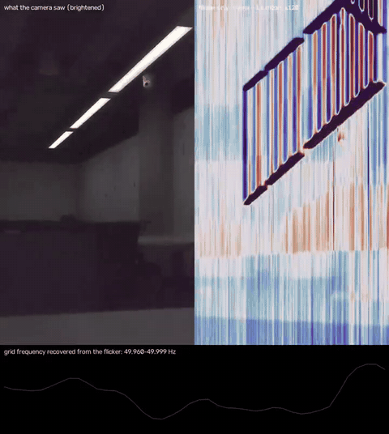 | 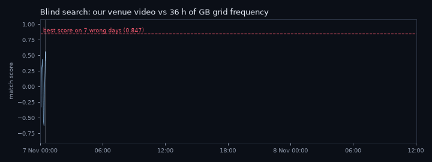 |
| *Left: what the phone saw. Right: the 100 Hz mains flicker isolated and amplified; the rolling shutter turns it into stripes.* | *Our 18-min venue video, matched against every second of the Elexon feed: **8 Nov 11:42:39 UTC** (camera clock: 11:42:37).* |

> UCL AgentVerse 2026 hackathon, Finance track. This is a pre-test evidence pack plus a reusable core library. Every number below links to the file it comes from. Evidence grades: **A** = independently reproduced on authentic inputs · **B** = executed with logs, reproduced only on a spot check or not at all · **C** = sourced research · **D** = hypothesis/illustration. Data labels: **REAL**, **SEMI-SYNTHETIC** (real grid data with injected noise), **SYNTHETIC**, **ILLUSTRATIVE**.

---

## We filmed a room at the venue today. Without reading any metadata, GhostClock recovered the recording time from the lights' flicker, to within 2 seconds of the camera clock.

On 8 Nov 2026 the team filmed an **18.4-min phone video** at the venue (1080p60 HEVC, Blackmagic Camera app). People were talking during the recording, and speech masks the mains hum, so the investigation used the second, independent sensor: the **ceiling lights' 100 Hz flicker**, captured row by row by the phone's rolling shutter. This is modality fallback working as designed. GhostClock extracted the ENF from the flicker and searched **blind**, from the trace alone (no filename, no metadata), across the **entire live GB Elexon archive: 36.3 hours**.

| | |
|---|---|
| **GhostClock blind estimate** | **2026-11-08T11:42:39Z** |
| **Camera's own network-synced clock** (file metadata: `creation_time`, Blackmagic `dateRecorded`, timecode 11:42:37:00, never read by the analysis) | **2026-11-08T11:42:37Z** |
| **Error** | **2 s** over 36.3 h of searched grid history |
| Match strength | NCC **0.979**; the runner-up anywhere else in 36 h scores **≤ 0.826** (margin 0.153); the same trace scores **≤ 0.847** on each of 7 earlier wrong days |
| Robustness | The same second is found with quality gates of 15 dB and 18 dB; a re-run from the committed trace during packaging reproduced it identically |

Sources: [result.json](experiments/team_recordings_venue/blind/CASE_HERO_video_q15/result.json) · [q18](experiments/team_recordings_venue/blind/CASE_HERO_video_q18/result.json) · [re-run](experiments/team_recordings_venue/blind/REPRO_release_q15_result.json) · [camera-clock ground truth](experiments/team_recordings_venue/ground_truth_camera_clock.json) · [details](experiments/team_recordings_venue/README.md). Data: REAL, grade B (one recording).

| | |
|---|---|
| 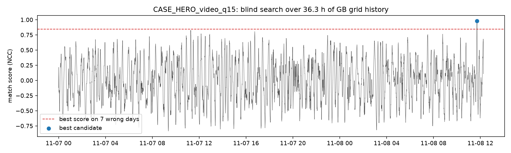 **Blind search over 36 h:** one peak | 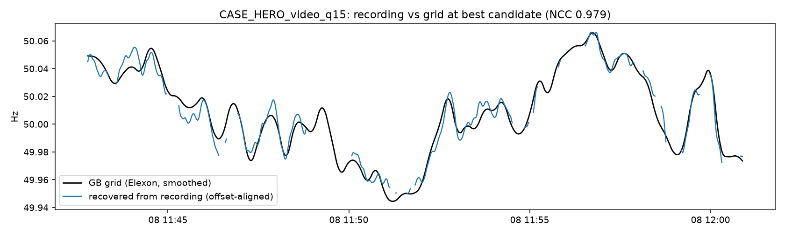 **Ceiling-light ENF vs the GB grid** at the found start |

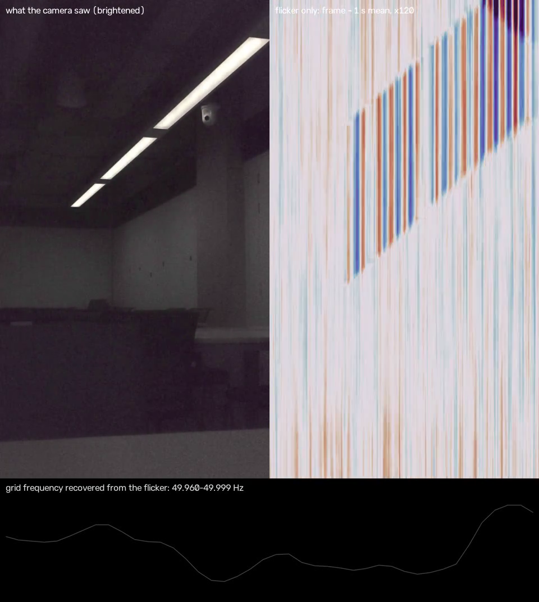

**The safeguard, live.** The same session produced a **49 s** test clip. Its best start scored 0.928, but 7 wrong days scored 0.929–0.937. That is too short to be unique, so GhostClock **correctly abstains** (`INCONCLUSIVE`) and asks for a longer recording. This is the duration gate doing its job ([result.json](experiments/team_recordings_venue/blind/TEST_49s_audio/result.json); the Argon agent reached the same verdict in [case d](experiments/c5_argon_agent/runs/case_d/trace.jsonl)).

**Reading notes.**

1. The reference is the phone's network-synced clock. The on-screen time.is slate was not separately read.
2. Only 7 wrong-day nulls were run, so p cannot go below 1/8. The evidence is the margin, not a p-value.
3. This is one recording, a REAL demonstration rather than a test-set statistic. The statistics on unseen data are below.
4. Audio and video from the same clip are not independent evidence of time. On the 49 s clip the two extractors agree (r = 0.900 in our recompute), which shows that both read the same physical signal.

## The user and the decision

- **User.** A UK insurance SIU investigator or complex commercial-property claims handler ([docs/USE_CASE.md](docs/USE_CASE.md)).
- **Decision.** Should a disputed claim supported by a phone or CCTV recording (fictional example: a £20k commercial claim) be paid on the normal path, or referred for further investigation? GhostClock contributes one piece of evidence: whether the recording's timing is corroborated, unresolved, or materially inconsistent with the claim.
- **Real cases where seconds of footage decided money.** FOS DRN-4534311: a theft claim lost because the CCTV clock could not be trusted. FOS DRN-4256057: a decline overturned over an 11-second clip. UK ENF evidence has been used in a murder trial since 2010. All sourced in [docs/CASE_STUDIES_AND_QA.md](docs/CASE_STUDIES_AND_QA.md).
- **Failure that would hurt them most.** A confident false "this was recorded at a different time" that leads to an unfair accusation. The gates are built to abstain instead: the calibrated null, the uniqueness margin, the no-ENF abstention and the human-review gate ([docs/RISK_CONTROLS.md](docs/RISK_CONTROLS.md)).

## What we found

| # | Finding | Number | Data | Grade | Source |
|---|---|---|---|---|---|
| 1 | **Audio dating on unseen data.** ENF-WHU holdout: 45 recordings from 15 days never used for tuning. Settings were frozen on dev and run once. Each 5-min excerpt was searched over its full 24 h reference (86,400 candidate offsets). | Answered **105/135 = 77.8%** [70.1, 84.0]; correct within ±5 s **105/105 = 100%** [96.5, 100]; no-ENF recordings falsely matched **0/153** [0, 2.5] | REAL | **A** | [RESULTS.json](experiments/c1_enfwhu_unseen_holdout/RESULTS.json), [verifier](reviews/director_verify_c1.py), [output](reviews/outputs/director_verify_c1.txt) |
| 2 | **Main weakness: wrong-day false matches.** A real-ENF excerpt searched against the *wrong* day's reference still produced a (wrong) match | **28/270 = 10.4%** [7.3, 14.6] at 5 min (target ≤ 5%) | REAL | **A** | [RESULTS.json](experiments/c1_enfwhu_unseen_holdout/RESULTS.json), [FAILURES.md](experiments/c1_enfwhu_unseen_holdout/FAILURES.md) |
| 3 | Sub-second precision against per-file refined ground truth | 31/34 = 91% [77.0, 97.0] within ±1 s; median error 0.18 s | REAL | **A** | [C1 README](experiments/c1_enfwhu_unseen_holdout/README.md) |
| 4 | **Video ENF** from rolling-shutter flicker in a real 30 fps phone-style clip (Zenodo 3549379, Spanish grid, co-recorded mains reference) | r = 0.9954, residual 1.07 mHz, n = 633 windows; unique alignment (best other lag r = 0.685); naive frame-mean r = 0.38 | REAL | B | [RESULTS.json](experiments/c4_video_rolling_shutter/RESULTS.json), [verifier output](reviews/outputs/director_verify_c4.txt) |
| 5 | ENF placed that video's start ~11.5 s from where its filename timestamps put it | best lag 81.5 s vs filename 70 s | REAL | B | [C4 FAILURES.md](experiments/c4_video_rolling_shutter/FAILURES.md) |
| 6 | **Calibrated statistics prevent false accusations.** A wrong-day spurious match reaches r = 0.76. Naive statistics give p ≈ 1e-58; the empirical look-elsewhere null gives p ≈ 0.10, so the result is `INCONCLUSIVE` | p_iid = 6.65e-58 vs p_emp = 0.0987 | REAL grid data | B | [W10 FINDINGS.md](experiments/w10_matcher_and_null_calibration/FINDINGS.md) |
| 7 | **The open-source baseline breaks on gaps.** nate-griff/enf is off by 30,907 s on a 5-min clip with a 40 s gap; the GhostClock matcher's error is 0 s | 20% dropout: baseline 0/12, GhostClock 12/12 within ±5 s | SEMI-SYNTHETIC | B | [W10 RESULTS.json](experiments/w10_matcher_and_null_calibration/RESULTS.json) |
| 8 | **Short clips against today's live feed are not datable.** P(top-1 within ±15 s) against real Elexon 15 s data | 2 min **0.10** · 5 min 0.75 · 10 min 0.95 · 20 min 0.99 (n = 1000 per cell) | SEMI-SYNTHETIC | **A** | [C2 RESULTS.json](experiments/c2_gb_reference_and_feasibility/RESULTS.json), [W02 reproduction](experiments/w02_independent_reproduction_of_c2/W02_reproduce_C2.md) |
| 9 | **The no-reference speed-tamper check is weak.** "8 s at 1.75×" was flagged in 20/45 cases; untouched clips raised false alarms 18/225 times | 44% [31, 59] detection; 8.0% [5.1, 12.3] false alarms | REAL audio + SYNTHETIC edits | B | [C3 RESULTS.json](experiments/c3_speed_and_splice/RESULTS.json) |
| 10 | **Our venue video dated blind against the live GB grid.** 18.4 min, ceiling-light flicker, 36.3 h search window | **11:42:39Z vs camera clock 11:42:37Z: error 2 s**; NCC 0.979; runner-up 0.826; wrong days ≤ 0.847 (7 nulls, so p ≥ 1/8) | REAL | B | [team_recordings_venue](experiments/team_recordings_venue/README.md) |
| 11 | **Correct abstention on a short clip.** 49 s venue clip: 7 wrong days scored 0.929–0.937, above its best of 0.928 | `INCONCLUSIVE` (designed duration safeguard) | REAL | B | [TEST_49s_audio](experiments/team_recordings_venue/blind/TEST_49s_audio/result.json) |
| 12 | **Argon investigator with a code gate**, 5 real cases: all 5 statuses as expected. On the false-claim case the gate **overrode** Argon's `MATCH_SUPPORTED` with `MATERIAL_DISCREPANCY_REVIEW`. A fixed pipeline without Argon gets the same 5 statuses | 11 Argon calls, 129,993 tokens; start error 0.17 s (case a) | REAL (logged runs) | B | [C5 README](experiments/c5_argon_agent/README.md), [case e trace](experiments/c5_argon_agent/runs/case_e/trace.jsonl) |

Full evidence with every caveat: [docs/EVIDENCE.md](docs/EVIDENCE.md). Machine-readable version: [results/summary.json](results/summary.json).

## More figures (all REAL unless marked)

| | |
|---|---|
| 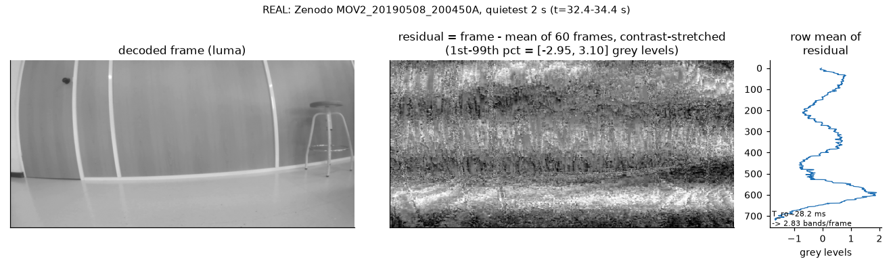 **Video:** mains flicker bands, made visible | 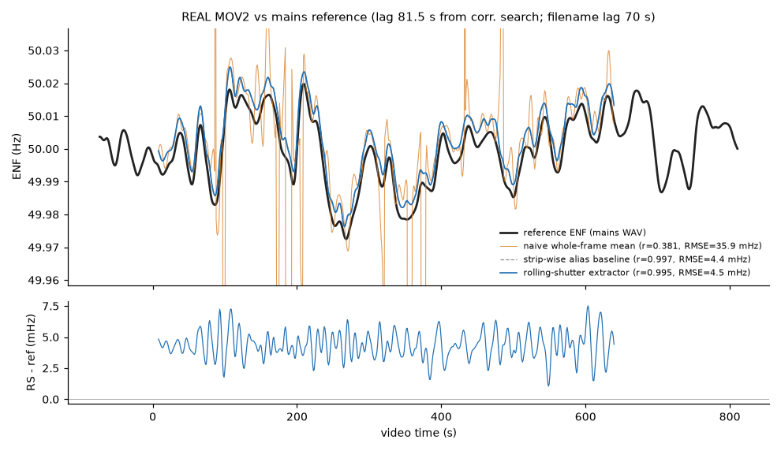 **Video:** ENF trace vs mains reference, naive vs rolling shutter |
| 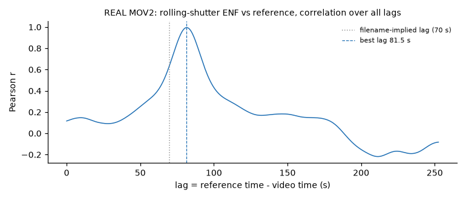 **Video:** one unique alignment peak | 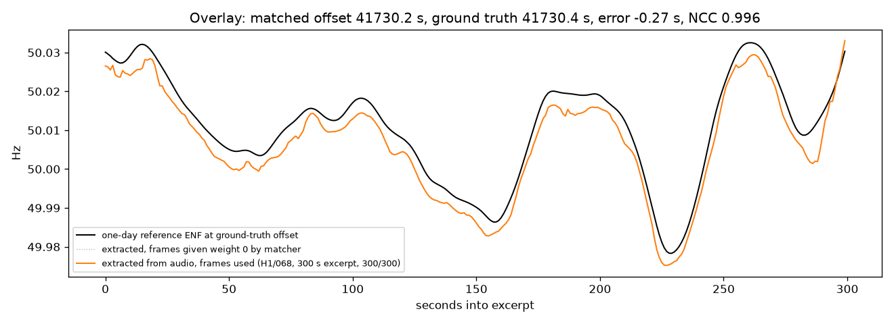 **Audio:** ENF vs reference, error −0.27 s |
| 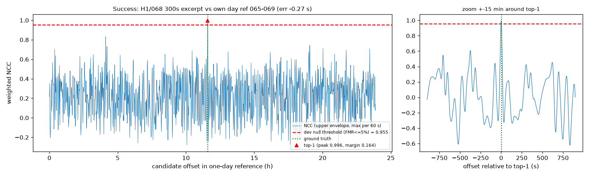 **Audio:** full-day match landscape, one peak above threshold | 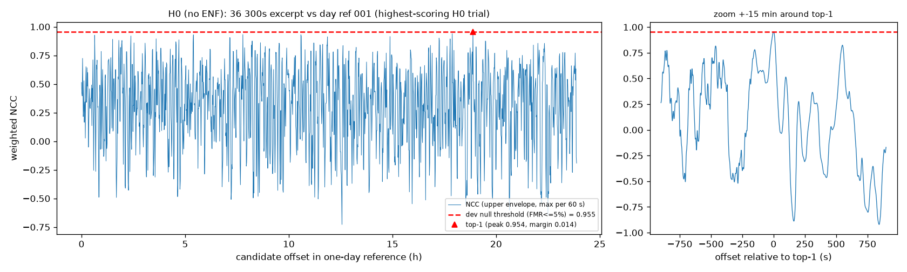 **Abstention:** a no-ENF clip never crosses the threshold |
| 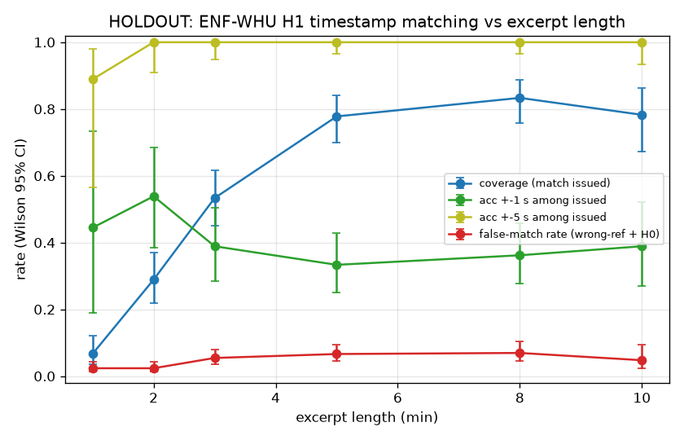 **Unseen holdout:** coverage and accuracy vs clip length | 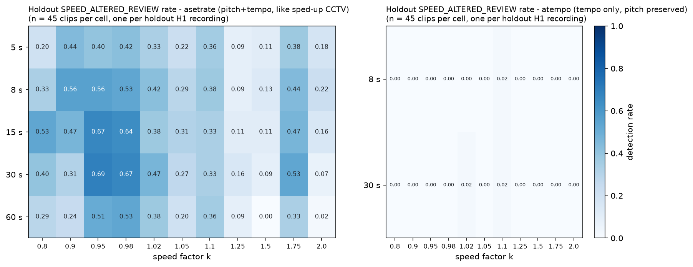 **Failure:** where the speed check fails (REAL + SYNTHETIC) |

More: [reference sources](results/figures/04_reference_neso_vs_elexon_REAL.png), [hum ridge](results/figures/05_audio_mains_hum_ridge_REAL.png), [a failure landscape](results/figures/09_day_landscape_failure_REAL.png), [speed-up spectrum](results/figures/11_speedup_shifts_hum_REAL_audio_SYNTH_edit.png).

## Concept renders (ILLUSTRATIVE)

The team's concept visualisations of the investigator experience. **Fictional claim scenarios; the figures shown on screen are not measured results.** Measured results are only in the tables above.

| Split-screen: CCTV vs isolated light flicker | Investigator walkthrough concept |
|---|---|
| 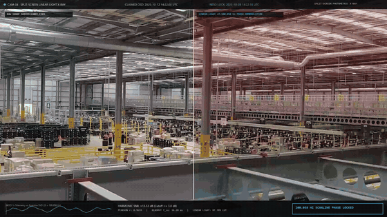 | 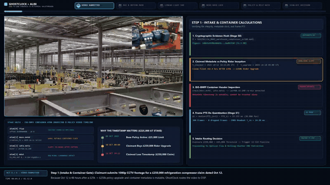 |

## How it works

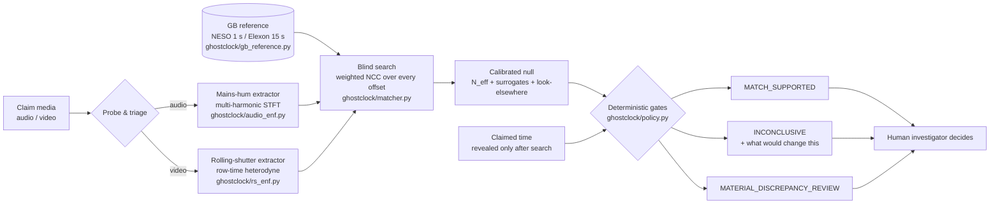

1. **Extract.** Audio: band-pass 45–360 Hz, 16 s Hann STFT with a 1 s hop, harmonics 1–7 combined by SNR, parabolic refinement. This gives f(t) plus a per-frame quality q. Video: estimate the sensor read-out time T_ro, heterodyne per-row brightness at row-time resolution, then track the 100 Hz flicker.
2. **Load the reference.** NESO 1 s (published about 5–6 weeks after month end) or Elexon 15 s (about 1–2.5 min behind real time), cleaned of known traps: timezone-shifted months, flat-filled outages and 0.0 Hz placeholders ([docs/DATA.md](docs/DATA.md)).
3. **Blind search.** A quality-weighted, gap-aware normalised cross-correlation over every candidate offset. The claimed time is **not** given to the search.
4. **Calibrate.** Bartlett effective sample size, time-reversed reference surrogates and a look-elsewhere correction across the whole window.
5. **Gate.** Fixed thresholds in code, set on dev data only: duration, signal variance, null significance, minimum score, uniqueness margin, RMSE and split-half consistency. Each gate writes a machine-readable reason, and every `INCONCLUSIVE` comes with a `what_would_change_this` list.
6. **Decide.** The human investigator decides. GhostClock has no code path that denies a claim.

The calculations are kept separate from judgement: extractors, matcher and policy are deterministic Python ([ghostclock/](ghostclock/README.md)). In the agent loop ([C5](experiments/c5_argon_agent/README.md)), Gemini 4 Argon chooses what to run and writes the explanation. It never produces a measured number, and the code gate overrides its proposed status whenever the two disagree.

## Testing on unseen data

- **Held-out data.** ENF-WHU is split by recording day (seed 20261108, frozen before tuning). Dev has 85 H1 recordings / 13 days and 33 H0; holdout has 45 H1 / 15 days and 17 H0. The holdout was run **once** with frozen settings ([split.json](experiments/c1_enfwhu_unseen_holdout/split.json), [frozen.json](experiments/c1_enfwhu_unseen_holdout/frozen.json)).
- **Negative controls.** No-ENF recordings (H0), wrong-day references and surrogate references.
- **Baselines.** Metadata-only, naive i.i.d. statistics, the open-source nate-griff/enf (compared, not vendored), and the naive whole-frame mean for video.
- **Uncertainty.** Every rate carries its denominator and a Wilson 95% CI.
- **Independent reproduction.** The director re-derived the headline numbers with separate code ([reviews/](reviews/README.md)). Worker W02 independently reproduced the reference feasibility table ([W02](experiments/w02_independent_reproduction_of_c2/README.md)).

Details: [docs/TESTING.md](docs/TESTING.md).

## Risk controls

The limits are enforced in code: eight-plus deterministic gates in [ghostclock/policy.py](ghostclock/policy.py) with frozen `PolicyThresholds`. The claimed timestamp is hidden from the search. GhostClock abstains when the signal or reference is inadequate and gives a three-way status with explicit reasons. A human-review gate sits on every outcome. Synthetic fixtures in the UI are labelled. Details: [docs/RISK_CONTROLS.md](docs/RISK_CONTROLS.md).

## How Gemini 4 Argon investigates

**Model:** `gemini-4-argon-high`, called through the Antigravity CLI on the hackathon project. These are REAL, logged runs: **5 cases, 11 Argon calls, 129,993 tokens** ([C5](experiments/c5_argon_agent/README.md), grade B).

**The division of labour.** Argon **directs the investigation**: it reads a blinded probe, chooses the modality, harmonics and analysis window, and calls the tools. It then **writes the reviewer's explanation** and what would change its mind. The deterministic tools measure, and every number in Argon's explanation is checked against the tool outputs. A **code gate sets the status**, so Argon can never issue an unsupported adverse finding. Argon never sees filenames, ground truth, metadata times or the claimed time.

**Case a** (ENF-WHU holdout H1 011, real audio) → `MATCH_SUPPORTED`, start error **0.17 s**. Excerpt from [runs/case_a/trace.jsonl](experiments/c5_argon_agent/runs/case_a/trace.jsonl):

```text
step 0  tool   probe(media)          -> duration 734.0 s, audio only; per-harmonic SNR h1 4.51, h2 193.02, h3 125.59, h4 280.63, h5 9.91, h6 183.63, h7 9.38
step 1  argon  (10,125 tokens, 52.8 s) -> extract_and_match(audio, harmonics [2,3,4,6], window 0-600 s)
               rationale: "longest calibrated window ... excluding low-SNR harmonics 1, 5, and 7 (4.51, 9.91, and 9.38)"
step 2  tool   extract_and_match     -> peak NCC 0.99967, second peak 0.78237, margin 0.2173, frozen threshold (600 s) 0.87678 -> passes
step 3  argon  (7,190 tokens, 66.7 s)  -> decide: proposes MATCH_SUPPORTED; explanation cites only numbers from steps 0-2
step 4  gate                         -> MATCH_SUPPORTED  ("peak NCC 0.99967 > frozen threshold 0.87678 for 600 s")
```

**Case e** (the same recording, plus a **false claimed start of +7200 s** that only the gate sees) → **the gate overrides Argon.** Excerpt from [runs/case_e/trace.jsonl](experiments/c5_argon_agent/runs/case_e/trace.jsonl):

```text
step 1  argon  -> extract_and_match(audio, harmonics [2,3,4,6], window 0-600 s)
step 2  tool   -> peak NCC 0.99967 > threshold 0.87678
step 3  argon  -> decide: proposes MATCH_SUPPORTED (it cannot see the claim)
step 4  gate   -> MATERIAL_DISCREPANCY_REVIEW  ("claimed start differs from the ENF-supported start by -7200 s (> 60 s tolerance)")
step 5  gate   -> "Argon proposed MATCH_SUPPORTED, gate decided MATERIAL_DISCREPANCY_REVIEW: gate wins"
```

| Case | Input (blinded) | Argon calls | Tokens | Status (gate) | Trace |
|---|---|---|---|---|---|
| a | holdout H1 011, own-day reference | 2 | 17,315 | `MATCH_SUPPORTED`, error 0.17 s | [trace](experiments/c5_argon_agent/runs/case_a/trace.jsonl) · [report](experiments/c5_argon_agent/runs/case_a/report.md) |
| b | holdout H0 (no ENF) | 3 | 37,390 | `INCONCLUSIVE` | [trace](experiments/c5_argon_agent/runs/case_b/trace.jsonl) · [report](experiments/c5_argon_agent/runs/case_b/report.md) |
| c | H1 011 against the **wrong day** | 3 | 38,510 | `INCONCLUSIVE` (no false match) | [trace](experiments/c5_argon_agent/runs/case_c/trace.jsonl) · [report](experiments/c5_argon_agent/runs/case_c/report.md) |
| d | the team's 49 s venue clip | 1 | 14,588 | `INCONCLUSIVE` (under 60 s; asks for a longer recording) | [trace](experiments/c5_argon_agent/runs/case_d/trace.jsonl) · [report](experiments/c5_argon_agent/runs/case_d/report.md) |
| e | H1 011 + false claim (+7200 s) | 2 | 22,190 | `MATERIAL_DISCREPANCY_REVIEW` (**gate overrode Argon**) | [trace](experiments/c5_argon_agent/runs/case_e/trace.jsonl) · [report](experiments/c5_argon_agent/runs/case_e/report.md) |

**Ablation, stated accurately.** A fixed pipeline without Argon reaches the same statuses on these 5 cases ([ablation runs](experiments/c5_argon_agent/README.md)). Argon's contribution is directing the investigation and producing an auditable, number-checked explanation, while the deterministic gate guarantees it can never issue an unsupported adverse finding. **We do not claim Argon improves accuracy;** five cases cannot measure that. The caveats are in the C5 README: look-elsewhere risk when several configurations are tried, uncalibrated harmonic subsets, precomputed traces, and 40–165 s per call.

**Gemini also helped build this repository.** 20 Gemini 4 Argon worker agents, run headless through the Antigravity CLI under a supervisor, carried out literature research, GB reference-data engineering, extractor and matcher studies, and independent reproductions. They worked alongside the team's own engineering workstreams (WS-C1 to WS-C5), and every headline number was re-verified separately ([process/PROCESS.md](process/PROCESS.md), [reviews/](reviews/README.md)). Worker studies (`w*`) are marked **not independently re-verified** unless stated otherwise. The investigator-UI prototypes ([prototypes/ui/](prototypes/ui/README.md)) are ILLUSTRATIVE.

## Limitations

The most important ones are listed here; the full list is in [docs/LIMITATIONS.md](docs/LIMITATIONS.md).

- Wrong-day false matches run at 10.4% on 5-min clips. A single-day search must not be the decision: the product gate must require uniqueness across all candidate days and report the runner-up day. Fixing the threshold needs a **fresh** test set, because this holdout has now been seen.
- Same-day dating against the public 15 s feed needs clips of **10–20 min or more**. NESO 1 s data arrives about 5–6 weeks late.
- The speed and splice checks are triage flags only. Video fails under anti-flicker exposure or weak flicker. Two real videos have been dated (Zenodo MOV2 and the venue video). That is two clips, not a test set.
- ENF-WHU ground truth is good only to about ±5 s.

## Repository map

| Path | What |
|---|---|
| [ghostclock/](ghostclock/README.md) | Reusable core: audio and video extractors, GB reference loader, matcher, decision policy, CLI tools |
| [experiments/](experiments/README.md) | One folder per study, each with scripts, README, RESULTS.json and FAILURES.md (`c5_argon_agent` = the Argon investigator; `team_recordings_venue` = the hero result) |
| [reviews/](reviews/README.md) | The director's independent verification scripts and their saved outputs |
| [results/](results/summary.json) | Curated figures and `summary.json` |
| [docs/](docs/EVIDENCE.md) | Evidence, testing, risk controls, rubric map, data, limitations, use case, capture protocol |
| [prototypes/ui/](prototypes/ui/README.md) | Two static investigator-UI prototypes (ILLUSTRATIVE) |
| [process/](process/PROCESS.md) | How the work was produced (multi-agent orchestration) |
| [tests/](tests/test_smoke.py) | Synthetic smoke test of matcher and policy |

## Quickstart

```bash
python -m venv .venv && .venv/Scripts/activate      # Windows; use .venv/bin/activate on Linux/macOS
pip install -r requirements.txt
python tests/test_smoke.py                            # SYNTHETIC plumbing check, no data needed

# Re-derive the headline holdout numbers from the committed trial table (no data download needed)
python reviews/director_verify_c1.py
# Re-derive the video result from the committed traces
python reviews/director_verify_c4.py

# Fetch GB reference data (NESO monthly CSV / Elexon API) into data/gb and load one hour
python -m ghostclock.gb_reference --source ELEXON --start 2026-11-08T09:00Z --end 2026-11-08T10:00Z --fetch

# Quick check of your own recording (needs ffmpeg/ffprobe on PATH or GHOSTCLOCK_FFMPEG_DIR)
python -m ghostclock.tools.quick_check path/to/clip.mp4
# Blind-date an extracted trace against the live Elexon archive (needs data/gb/elexon_live.parquet)
python -m ghostclock.tools.blind_match experiments/team_recordings_venue/A001_11081142_C004/video_rs_trace_dark.csv --case HERO --qmin 15 --search-start 2026-11-07T00:00Z
```

Environment variables: `GHOSTCLOCK_DATA` (default `data/`), `GHOSTCLOCK_GB_DIR` (default `data/gb`), `GHOSTCLOCK_OUT` (default `out/`) and `GHOSTCLOCK_FFMPEG_DIR`. Raw datasets are **not** committed. To rebuild a study, see its README. Study scripts are archived as run: they refer to the original workspace layout, written as `<WORKSPACE>`.

## Data sources and licences

| Source | Use | Licence / terms |
|---|---|---|
| ENF-WHU dataset (Hua et al.) | audio H1/H0 recordings + references | MIT |
| Zenodo record 3549379 (ENF Moving Video Database, Vigo) | real rolling-shutter video + mains reference | CC-BY-4.0 (per C4 METHOD.md) |
| NESO historic 1 s system frequency | GB reference (archive) | NESO Open Data Licence |
| Elexon BMRS / Insights API `system/frequency` | GB reference (live, 15 s) | Elexon BMRS data terms (not re-checked) |

SHA-256 sums, timezone traps and outage masks: [docs/DATA.md](docs/DATA.md).

## Acknowledgements

ENF-WHU (MIT), Zenodo 3549379, NESO and Elexon BMRS for open data. The open-source baselines [nate-griff/enf](https://github.com/nate-griff/enf) and [CoRoe/enf-matching](https://github.com/CoRoe/enf-matching) were compared against but are not vendored here. Built at UCL AgentVerse 2026.

## Licence

MIT, see [LICENSE](LICENSE).
