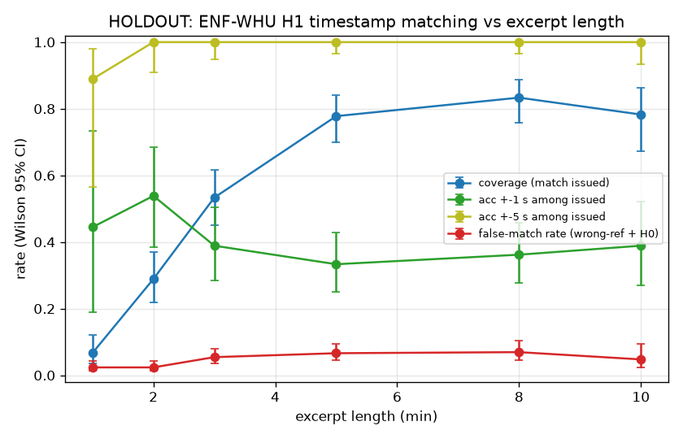

# Testing protocol and results

The project-wide frozen protocol is [source/eval_protocol.md](source/eval_protocol.md), written by W10. This page summarises how each headline number was produced and where to find it.

## 1. Unseen-data test: ENF-WHU audio dating (C1, grade A)

| Item | Value | Source |
|---|---|---|
| Dataset | ENF-WHU: H1 = real recordings with ENF, each with a 24 h one-day reference; H0 = recordings without ENF | [C1 README](../experiments/c1_enfwhu_unseen_holdout/README.md) |
| Split | Grouped by **recording day** for H1 and by source file for H0. Seed 20261108, **frozen before any tuning**. Dev: 85 H1 / 13 days and 33 H0. Holdout: 45 H1 / 15 days and 17 H0 | [split.json](../experiments/c1_enfwhu_unseen_holdout/split.json), [make_split.py](../experiments/c1_enfwhu_unseen_holdout/make_split.py) |
| Tuning (dev only) | 9 matcher settings × 3 statistics. Selected: q-weighting, 0.05 Hz clip, no high-pass, statistic = peak | [tuning_dev_round_all.csv](../experiments/c1_enfwhu_unseen_holdout/tuning_dev_round_all.csv) |
| Decision rule | Issue a match only if the peak NCC exceeds a per-length threshold, set on **dev null trials** so the dev false-match rate is ≤ 5%. Thresholds: 1 min 0.9976, 2 min 0.9929, 3 min 0.9812, 5 min 0.9553, 8 min 0.9119, 10 min 0.8768 | [frozen.json](../experiments/c1_enfwhu_unseen_holdout/frozen.json), plus a [snapshot taken before the holdout run](../experiments/c1_enfwhu_unseen_holdout/frozen_snapshot_before_holdout.json) |
| Holdout run | **Once**, with frozen settings. Each excerpt is searched over its full 24 h reference (86,400 offsets). 3 excerpts per file per length | [final_eval.py](../experiments/c1_enfwhu_unseen_holdout/final_eval.py), [log](../experiments/c1_enfwhu_unseen_holdout/logs/final_holdout.log) |
| Negative controls | Each H1 excerpt against **2 wrong-day** references. H0 excerpts against 3 references | [RESULTS.json](../experiments/c1_enfwhu_unseen_holdout/RESULTS.json) `protocol` |
| Ground truth | README rule: the lag of the noise-free H1_ref inside the day reference. This is good to about ±5 s, so ±1 s claims use per-file refined ground truth only | [DATASET_NOTES.md](../experiments/c1_enfwhu_unseen_holdout/DATASET_NOTES.md), [gt_w16.json](../experiments/c1_enfwhu_unseen_holdout/gt_w16.json) |
| Uncertainty | A Wilson 95% CI on every rate, always with its denominator | [RESULTS.json](../experiments/c1_enfwhu_unseen_holdout/RESULTS.json) |
| Independent check | The director recomputed every count from the raw trial table | [director_verify_c1.py](../reviews/director_verify_c1.py), [output](../reviews/outputs/director_verify_c1.txt) |

**Holdout results by clip length.** Each row gives coverage, the share of issued matches within ±5 s, and false matches. The underlying REAL data is the committed [trial table](../experiments/c1_enfwhu_unseen_holdout/trials/final_w16_q_clip05_holdout.parquet).

| Length | Answered | Correct ±5 s among answered | Wrong-day false match | H0 false match |
|---|---|---|---|---|
| 1 min | 9/135 | 8/9 | 10/270 | 0/153 |
| 2 min | 39/135 | 39/39 | 10/270 | 0/153 |
| 3 min | 72/135 | 72/72 | 23/270 | 0/153 |
| **5 min** | **105/135 = 77.8% [70.1, 84.0]** | **105/105 = 100% [96.5, 100]** | **28/270 = 10.4% [7.3, 14.6]** | **0/153 [0, 2.5]** |
| 8 min | 105/126 | 105/105 | 19/252 | 1/36 |
| 10 min | 54/69 | 54/54 | 7/138 | 0/9 |

**What this test does not cover.** The pooled false-match rate is 28/423 = 6.6% [4.6, 9.4], which is above the 5% set on dev. The wrong-day threshold therefore needs re-calibration on a fresh test set ([LIMITATIONS.md](LIMITATIONS.md)).

## 2. Baselines

| Baseline | Where | Result | Grade |
|---|---|---|---|
| **M0: metadata only.** Trust the claimed or filename timestamp | W10 holdout | Coverage 0/45 by construction; a spoofed timestamp is accepted 45/45 | B |
| **M1: open-source nate-griff/enf** (compared, not vendored) | W10, ENF-WHU holdout | Always issues a top-1, so H0 false positives 17/17 and wrong-day 45/45. With a 0.45 correlation gate: selective accuracy 10/26, H0 false positives 4/17, wrong-day 21/45 | B |
| M1 under interior gaps | W10, semi-synthetic NESO | 20% dropout: 0/12 within ±5 s (GhostClock 12/12). A 40 s gap puts it off by −30,907 s | B |
| **M2: naive i.i.d. Fisher-z significance** | W10, ENF-WHU holdout | False positives on 107/107 of all negatives | B |
| **Naive whole-frame mean** (video) | C4, real MOV2 | r = 0.381 vs 0.9954 for rolling shutter | B (director recomputed the rolling-shutter side) |
| Strip-wise alias baseline (video) | C4, real MOV2 | r = 0.9967. **It matches rolling shutter at 30 fps**; rolling shutter is needed only at 25 fps | B |

Sources: [W10 RESULTS.json](../experiments/w10_matcher_and_null_calibration/RESULTS.json) (`experiment_2_enf_whu_real_audio.holdout_v2_frozen`, `experiment_1_gb_neso_1s_benchmark.dropout_ablation_w10_vs_nate_griff`) and [C4 RESULTS.json](../experiments/c4_video_rolling_shutter/RESULTS.json).

## 3. Null calibration (W10, grade B, not reproduced)

Correlation p-values that assume independent samples are badly wrong for smooth, autocorrelated grid signals searched over 86,400 offsets. The matcher computes:

- Bartlett effective sample size N_eff from the trace's autocorrelation.
- An empirical tail from **time-reversed reference surrogates** in Fisher-z space.
- A **look-elsewhere** correction using the effective number of independent candidate shifts M_eff across the whole window.

Example: a wrong-day spurious match reaches r = 0.7607. The naive p is 6.65e-58; the calibrated p_emp is 0.0987, so the result is `INCONCLUSIVE`. Across three null families on GB NESO data (no ENF, wrong date, surrogate reference; 15 trials each) the calibrated matcher had 0/15 false positives in each, while the naive and nate-griff baselines had 15/15. Small n: the CI upper bound is 20%.

Sources: [W10 FINDINGS.md](../experiments/w10_matcher_and_null_calibration/FINDINGS.md), [RESULTS.json](../experiments/w10_matcher_and_null_calibration/RESULTS.json) `null_calibration_families`, [figure](../experiments/w10_matcher_and_null_calibration/plots/fig1_null_calibration_and_look_elsewhere.png).

## 4. Reference feasibility (C2, grade A via W02)

SEMI-SYNTHETIC test: real NESO and Elexon data with injected noise at σ = 2 mHz, a 24 h search window and n = 1000 per cell. Success means the top-1 is within ±15 s.

| Clip | 1 s ref (NESO) | 15 s ref, block-averaged | Real Elexon 15 s (2026) | Real Elexon, linear interpolation to 1 s (W02) |
|---|---|---|---|---|
| 2 min | 1.00 | 0.88 | **0.10** | 0.18 |
| 5 min | 1.00 | 1.00 | **0.75** | 0.81 |
| 10 min | 1.00 | 1.00 | **0.95** | 0.985 |
| 20 min | 1.00 | 1.00 | **0.99** | 0.998 |

W02 independently reproduced every column within ±2.3% (n = 400). Sources: [C2 RESULTS.json](../experiments/c2_gb_reference_and_feasibility/RESULTS.json), [W02_reproduce_C2.md](../experiments/w02_independent_reproduction_of_c2/W02_reproduce_C2.md).

## 5. Manipulated and bad inputs

| Input | Behaviour | Source |
|---|---|---|
| No-ENF audio (H0) | 0/153 false matches at 5 min on the holdout | C1 |
| Hum that is not the grid | Matches nowhere in 28 days; abstains | [EVIDENCE.md §4](EVIDENCE.md) |
| Flat 50.000 Hz tone or flat-filled reference outage | `GATE_FLAT_SIGNAL_FAILED`; outage rows masked | [W10 FAILURES.md](../experiments/w10_matcher_and_null_calibration/FAILURES.md) |
| Duplicated hour in the reference (ENF-WHU 090/091) | `GATE_UNIQUENESS_FAILED` (margin 0.000), so `INCONCLUSIVE` | W10 FAILURES.md |
| Spoofed metadata timestamp | Ignored by the search. The claimed time is compared only after the search is frozen | [policy.py](../ghostclock/policy.py) |
| Speed-up / tempo edit | Weak detection (44% at 1.75×, 8% false alarms); flag only | [C3](../experiments/c3_speed_and_splice/README.md) |
| MP3/AAC at 32 kbps | Median r changes by ≤ 0.0002 (W06, dev) | [W06](../experiments/w06_audio_extractor/README.md) |

## 6. Video (C4, grade B)

One real clip. Rolling-shutter ENF r = 0.9954 (n = 633 overlapping windows, so not independent). Residual 1.07 mHz after removing a constant +4.35 mHz timebase bias (87 ppm). Unique lag: the best value more than 10 s away is 0.685. Synthetic cases cover 25/30/60 fps, anti-banding exposure and weak flicker. Sources: [C4 README](../experiments/c4_video_rolling_shutter/README.md), [director check output](../reviews/outputs/director_verify_c4.txt).

## 7. Real venue recording (grade B)

The 18.4-min venue video was searched blind over 36.3 h of live Elexon data: best 11:42:39Z against the camera clock's 11:42:37Z (an **error of 2 s**). NCC 0.979, runner-up 0.826, 7 wrong days ≤ 0.847. With only 7 nulls, p ≥ 1/8, so the evidence is the margin. The 49 s clip abstains. See [team_recordings_venue](../experiments/team_recordings_venue/README.md).

## 8. Agent runs (C5, grade B)

There were 5 real Argon cases, with all statuses as expected. A no-Argon ablation reaches the same statuses, so no accuracy gain is claimed ([C5](../experiments/c5_argon_agent/README.md)).

## 9. Smoke test

[tests/test_smoke.py](../tests/test_smoke.py) is a SYNTHETIC plumbing check with no data. A 10-min excerpt with a 40 s gap is found at the right offset with `MATCH_SUPPORTED`, and a pure-noise trace is `INCONCLUSIVE`. It feeds no reported metric.
