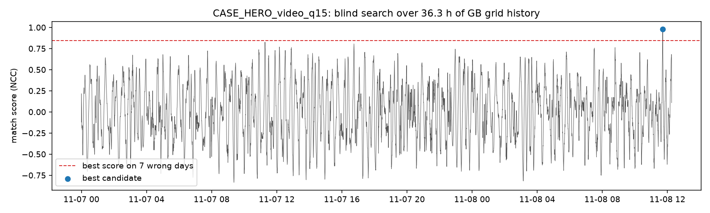
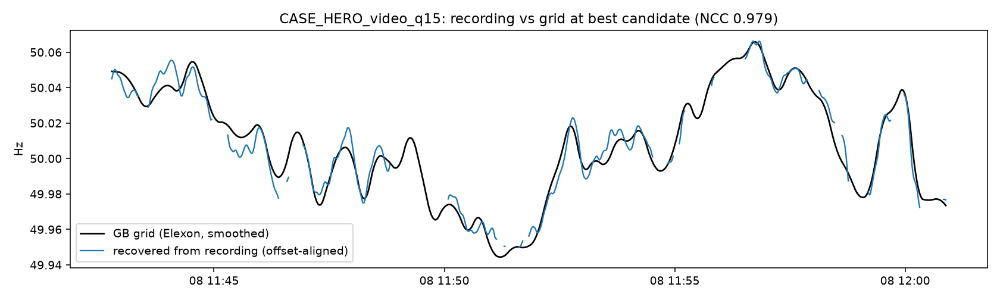

# Team recordings at the venue (08 Nov 2026): "we filmed this today, and the grid told us when"

**Data: REAL. Grade: B** (one recording). The director ran the analysis. During release packaging, the blind search was re-run from the committed trace with the path-portable tool, and it found the same start second and the same scores ([REPRO_release_q15_result.json](blind/REPRO_release_q15_result.json)).

**Result: GhostClock's blind estimate is 11:42:39Z. The camera's own network-synced clock says 11:42:37Z. The error is 2 s, over 36.3 h of searched grid history** ([ground_truth_camera_clock.json](ground_truth_camera_clock.json)).

The media files are not distributed. Their SHA-256 sums are in [SHA256SUMS.txt](SHA256SUMS.txt).

## Hero: 18.4-min phone video dated blind against the live GB grid

| Item | Value | Source |
|---|---|---|
| Recording | `A001_11081142_C004`: 1080p60 HEVC, Blackmagic Camera app, shutter speed in the metadata 1/8000 (shutter angle 2.7°), 1102.8 s; SHA-256 `DC2E3C97…98C5E` | [report.json](A001_11081142_C004/report.json), [SHA256SUMS.txt](SHA256SUMS.txt) |
| Audio | People were talking during the recording, and speech masks the mains hum (median q 5.9 dB), so the investigation used the light-flicker channel. **Modality fallback:** two independent sensors in one file | [report.json](A001_11081142_C004/report.json) |
| Video ENF | Rolling-shutter extractor (C4 method, dark-scene mask) on ceiling-light flicker: 1088 windows, median q 18.0 dB, 20.8% of windows ≥ 20 dB, median 50.0069 Hz, T_ro = 6.5 ms | [video_dark_report.json](A001_11081142_C004/video_dark_report.json), [trace](A001_11081142_C004/video_rs_trace_dark.csv) |
| Blind search | Uses only the trace (no filename or metadata) over the **whole live Elexon archive**, 2026-11-07T00:00Z → 08T12:35Z (**36.3 h**). The reference is interpolated to 1 s and smoothed | [blind_match.py](blind_match.py) (portable copy: [`ghostclock/tools/blind_match.py`](../../ghostclock/tools/blind_match.py)) |
| **Result (quality gate 15 dB)** | Best start **2026-11-08T11:42:39Z**, against the camera clock **11:42:37Z**: an **error of 2 s**. NCC **0.979**. The runner-up anywhere in 36 h scores 0.826 (margin **0.153**). The same trace scores at most **0.847** on each of 7 earlier wrong days | [result.json](blind/CASE_HERO_video_q15/result.json), [landscape](blind/CASE_HERO_video_q15/landscape.png), [overlay](blind/CASE_HERO_video_q15/overlay.png) |
| Robustness (quality gate 18 dB) | **Same second**, 11:42:39Z. NCC 0.979, runner-up 0.810 (margin 0.169), wrong days ≤ 0.870 | [result.json](blind/CASE_HERO_video_q18/result.json) |

The flicker made visible: [team_demo_frame_v2.png](team_demo_frame_v2.png).

### Reading notes

1. **Ground truth = the camera's own network-synced clock.** It is recorded in the file metadata (`creation_time`, Blackmagic `dateRecorded`, timecode 11:42:37:00; [ground_truth_camera_clock.json](ground_truth_camera_clock.json)). The analysis never reads it: [blind_match.py](blind_match.py) takes only the extracted trace CSV. The on-screen time.is slate was not separately read.
2. **The p-value is floored by the size of the null.** Only 7 wrong-day nulls were run, so p_empirical cannot go below 1/8 = 0.125, and that is the value reported. The strength of the evidence is the **margin**: 0.979 against ≤ 0.847 on every wrong day (≤ 0.870 at q18) and ≤ 0.826 anywhere else in 36 h.
3. **This is one recording.** It is a REAL demonstration, not a test-set statistic.

## Designed safeguard: correct abstention on the 49 s test clip

| Item | Value | Source |
|---|---|---|
| Recording | `A001_11081103_C002`, 49.39 s, 60 fps, dark scene | [video_dark_report.json](A001_11081103_C002/video_dark_report.json) |
| Blind audio search (33 s usable trace, 36.3 h) | Best NCC 0.928, but **7 wrong days scored 0.929–0.937**, higher than the "best". Margin to the runner-up is 0.0005 | [result.json](blind/TEST_49s_audio/result.json), [landscape](blind/TEST_49s_audio/landscape.png) |
| Decision | **Too short to be unique, so it correctly abstains** (`INCONCLUSIVE`). This is the 60 s duration gate working as designed. The C5 Argon agent also returned `INCONCLUSIVE` and asked for a longer recording ([C5 case d](../c5_argon_agent/runs/case_d/report.json)) | — |
| Audio vs video ENF on the same clip | Director: r = 0.904, mean difference 0.7 mHz (computation not saved as a file). Release-engineer recompute with a simple method: **r = 0.900, mean difference −0.56 mHz, n = 34** | [av_agreement_recompute.py](av_agreement_recompute.py), [output](av_agreement_recompute_output.txt) |

**Audio and video from the same clip are not independent evidence of time.** They share the same recording and the same mains. Their agreement shows that both extractors read the same physical signal; it does not double the evidence.

## Earlier quick checks and a tool sanity check

- The dark-video check on the 49 s clip (median q 17.3 dB) is in [video_dark_report.json](A001_11081103_C002/video_dark_report.json).
- Run on the Zenodo MOV2 video from [C4](../c4_video_rolling_shutter/README.md), `quick_check` finds grid-like video ENF: median 50.000 Hz, wander 18.1 mHz, 75 windows, median q 57 dB ([report.json](MOV2_20190508_200450A/report.json)).
- `demo_frame.png` and `team_demo_frame*.png` are stills from the flicker visualiser ([`make_demo_video.py`](../../ghostclock/tools/make_demo_video.py)). `dark_video_check.py` and `blind_match.py` are archived exactly as run (with workspace paths). The portable versions are in [`ghostclock/tools/`](../../ghostclock/README.md).
