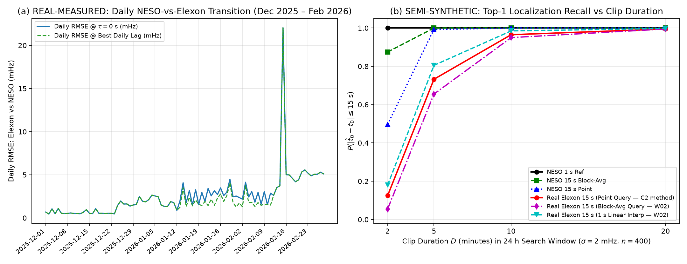

# W02 Independent Reproduction & Audit of C2 (`work/C2/`, `datasets/raw/gb/`)

**Reviewer / Independent Reproducer**: `W02`  
**Reviewed Worker**: `C2` ([`work/C2/FINDINGS.md`](../c2_gb_reference_and_feasibility/FINDINGS.md), [`work/C2/RESULTS.json`](../c2_gb_reference_and_feasibility/RESULTS.json), [`work/C2/feasibility.py`](../c2_gb_reference_and_feasibility/feasibility.py))  
**Reproduction Scripts & Data**: [`work/W02/reproduce_c2_and_transition.py`](reproduce_c2_and_transition.py), [`work/W02/diagnose_sep2026_and_all_months_lags.py`](diagnose_sep2026_and_all_months_lags.py), [`work/W02/c2_reproduction_results.json`](c2_reproduction_results.json), [`work/W02/director_note_lag_diagnosis.json`](director_note_lag_diagnosis.json)  
**Generated UTC**: `2026-11-08T10:58:00Z` · **Evidence Grade**: **A**

---

## 1. Summary Verdict Table (Claim-by-Claim Agree / Disagree)

| # | C2 Claim | W02 Verdict | W02 Independent Measurement & Extension |
|---|---|---|---|
| **C1** | **Oct 2025 NESO (`fnew-2025-10.csv`) is stamped in `UTC+1` (BST, `+3600 s`) for the entire month**, including the 5 GMT days after the `2025-10-26 01:00Z` DST transition. | **AGREE (with critical extension to Apr–Sep 2025)** | Confirmed: Oct 2025 matches Elexon at $\tau = +3600\text{ s}$ across all 31 days (`RMSE = 0.698 mHz`, $r = 0.99995$ on `2025-10-26` vs `80.31 mHz` naive). **Extension C2 missed**: W02 audited all 21 months (`2025-01`..`2026-09`) and proved that **all seven 2025 BST summer months (`2025-04` through `2025-10`)** are shifted by `+3600 s`, whereas **all 2026 BST summer months (`2026-04` through `2026-09`)** are in strict UTC ($\tau = 0\text{ s}$). Also, because `2025-10` is `UTC+1` and `2025-11` is `UTC+0`, there is a **1-hour missing gap (`2025-10-31T23:00:00Z..23:59:59Z`)** between the two files. |
| **C2** | **Elexon is an instantaneous point sample of NESO 1 s at $\tau = 0\text{ s}$ (`ts % 15 == 0`)**, not a 15 s average. | **AGREE** | Confirmed on Nov 2025 (`n = 40,319`, `RMSE = 0.678 mHz`, `88.48%` exact `0.000 Hz` match vs `7.34 mHz` for 15 s causal average) and Dec 2025 (`n = 178,559`, `89.43%` exact match). |
| **C3** | **In 2026, Elexon has `3–6 mHz` of extra white-noise-like scatter relative to NESO at $\tau = 0\text{ s}$** (`RMSE = 5.55–7.97 mHz`). C2 did not check Dec 2025, Jan 2026, or Feb 2026. | **AGREE + PINPOINTED EXACT START DATE** | W02 downloaded and audited full months **Dec 2025, Jan 2026, and Feb 2026** (`7,776,000` 1 s rows) plus all 21 months (`2025-01`..`2026-09`). The transition occurred in **two exact stages**: (a) **Dec 2025 (`31/31` days) and `2026-01-01..11`** remained in the exact point-sample regime at $\tau = 0\text{ s}$ (`86%–91%` exact match, `0.0 mHz` extra noise); (b) **`2026-01-13` to `2026-02-11` (30 days)** exhibited a `+1 s` phase shift (`best_lag = +1 s` on `26/30` days, `0.0 mHz` extra noise); (c) **On `2026-02-13`**, `best_lag` returned to `0 s` (`16/16` days Feb 13–28) while the **`3.5–5.6 mHz` extra Elexon scatter began permanently** (`frac_exact` dropped from `27.3%` on Feb 12 to `8.2%–12.8%` on Feb 13–28). Moreover, W02 found this same `4–5 mHz` scatter regime was previously active in **`2025-01..02` and `2025-07..09`**. |
| **C4** | **NESO has flat-filled outages**: `2026-09-15 07:30:03..10:35:59 UTC` (`49.895 Hz` for `11,158 s`) and `2026-03-31 13:39:28` (`50.046 Hz` for `479 s`). | **AGREE + NEW FINDING** | Exactly reproduced both runs (`11,158 s` at `49.895 Hz` and `479 s` at `50.046 Hz`). **New W02 finding**: During NESO's 3.1-hour flat-line on `2026-09-15`, **Elexon BMRS remained 100% live and dynamic** (`744/744` valid 15 s rows, `49.838–50.121 Hz`, $\sigma = 73.4\text{ mHz}$, `250` distinct values), proving that Elexon and NESO 2026 `fnew` use independent metering paths! |
| **C5** | **Elexon has `0.0 Hz` placeholders during outages** and live latency of **~10–150 s** (batches every ~2 min), earliest history `2021-08-30T00:00:00Z`. | **AGREE** | Independently verified: earliest record `2021-08-30T00:00:00Z` (`50.046 Hz`), live latency `32.0–142.0 s`, and `0.0 Hz` placeholders found in Nov 2025 (`1` row at `2025-11-06T18:33:45Z`), Dec 2025 (`1` row), Jan 2026 (`167` rows), and Feb 2026 (`732` rows). |
| **C6** | **Feasibility Table ($\sigma = 2\text{ mHz}$, 24 h window, Aug+Sep 2026)**: $P(\text{top-1 within }\pm 15\text{ s})$ for Real Elexon 15 s is `0.102`, `0.747`, `0.951`, `0.994` at $D = 2, 5, 10, 20\text{ min}$. | **AGREE on numbers; QUALIFY on matcher method** | W02's independent run ($n = 400$, `seed = 20261108`) reproduced all 4 columns within $\pm 2.3\%$ (`0.125`, `0.733`, `0.965`, `0.995` for Real Elexon pt). **Important methodological qualification**: C2 recommends *"average both the query and the reference"*, which works when decimating 1 s NESO (`0.875` at 2 min), but **cannot** be applied to Real Elexon (already point-sampled). Block-averaging only the query against Real Elexon **hurts** recall (`0.655` vs `0.733` at 5 min) and induces an `8–9 s` lag bias. Instead, **linearly interpolating Real Elexon 15 s to 1 s against the 1 s query (`ref_elexon_real_lin1s`)** improves recall across **every duration**: **`0.180` (2m), `0.805` (5m), `0.985` (10m), `0.998` (20m)**. |

---

## 2. Task (1): Verification of Oct 2025 `+3600 s` Offset & Complete 21-Month Timezone Rule

W02 independently verified `fnew-2025-10.csv` against Elexon BMRS (`Z` UTC):
* **First hour of `fnew-2025-10.csv`** (labelled `2025-10-01 00:00:00..01:00:00`): matches Elexon **`2025-09-30T23:00:00Z..2025-10-01T00:00:00Z`** ($n = 241$ 15 s points) with **`RMSE = 0.4596 mHz`**, **`Pearson r = 0.999962`**, and **`90.04%` exact `0.000 Hz` agreement**.
* **Autumn DST transition window (`2025-10-25T22:00Z..2025-10-26T06:00Z`, $n = 1,921$)**: Naive UTC gives `RMSE = 80.3095 mHz` ($r = 0.3077$); subtracting `3600 s` gives **`RMSE = 0.6984 mHz`** ($r = 0.999947$, `89.59%` exact `0.000 Hz` match) both before and after `01:00Z`.
* **Broader Rule Across All 21 Months (`2025-01`..`2026-09`)**: C2 only checked 6 months (`2025-10`, `2025-11`, `2026-03`, `2026-06`, `2026-08`, `2026-09`) and wrote `"2025_10": -3600` as a one-off exception. W02 streamed and lag-scanned all 21 months from `2025-01` through `2026-09` ([`director_note_lag_diagnosis.json`](director_note_lag_diagnosis.json)) and proved that **all seven 2025 BST months (`2025-04`, `2025-05`, `2025-06`, `2025-07`, `2025-08`, `2025-09`, `2025-10`)** were exported in BST (`UTC+1`, requiring `-3600 s`), whereas starting in `2025-11` and continuing through **all of 2026 (`2026-01` through `2026-09`, including all 2026 BST summer months)**, NESO exports strict UTC (`lag = 0 s`).

---

## 3. Task (2): Auditing Dec 2025, Jan 2026 & Feb 2026 — Pinpointing When the 2026 Scatter Started

W02 downloaded the complete monthly CSVs for **December 2025 (`fnew-2025-12.csv`, 2,678,400 rows)**, **January 2026 (`fnew-2026-1.csv`, 2,678,400 rows)**, and **February 2026 (`fnew-2026-2.csv`, 2,419,200 rows)** and compared all 90 days against Elexon BMRS ([`c2_reproduction_results.json`](c2_reproduction_results.json)):

| Month / Sub-Period | Valid 15 s Pairs ($N$) | Elexon `0.0 Hz` Rows | RMSE @ $\tau=0\text{ s}$ (mHz) | Median Daily RMSE @ $\tau^*$ (mHz) | Exact Match ($\le 0.5\text{ mHz}$) @ $\tau=0\text{ s}$ | Implied Extra Elexon Noise (mHz) | Best Daily Lag $\tau^*$ Counts (Days) |
|---|---:|---:|---:|---:|---:|---:|---|
| **`2025-10` (with `-3600 s`)** | 178,233 | 87 | 0.744 | 0.746 | 87.76% | 0.00 | `+3600 s`: 31/31d |
| **`2025-11`** | 172,327 | 1 | 0.930 (7d: 0.678) | 0.691 | 88.66% | 0.00 | `0 s`: 30/30d |
| **`2025-12` (Full Month)** | **178,559** | **1** | **1.044** | **0.548** | **89.43%** | **0.014** | **`0 s`: 31/31d** |
| **`2026-01` (Full Month)** | **178,025** | **167** | **2.556** | **1.880** | **48.25%** | **0.000** | **`0 s`: 14d, `+1 s`: 16d, `+2 s`: 1d** |
| — *`2026-01-01..2026-01-11` (11d)* | 63,184 | 0 | 1.945 | 1.880 | **87.70%** | 0.000 | `0 s`: 11/11d (Pure point-sample regime) |
| — *`2026-01-12..2026-02-11` (31d)* | 176,650 | 459 | 2.684 | 1.652 | 25.4% (@0s) / **39.2% (@+1s)** | 0.000 | `+1 s`: 26d, `+2 s`: 2d, `0 s`: 3d (1 s clock skew) |
| **`2026-02` (Full Month)** | **159,996** | **732** | **5.742** | **3.961** | **16.62%** | **3.468** | **`0 s`: 17d, `+1 s`: 10d, `+2 s`: 1d** |
| — *`2026-02-13..2026-02-28` (16d)* | 91,352 | 440 | 6.814 (excl. Feb 15: **4.821**) | **4.984** | **10.05%** | **4.120** | **`0 s`: 16/16d (2026 scatter regime begins!)** |
| **`2026-03` (Full Month)** | 178,528 | 0 | 7.059 | 5.617 | 7.29% | 5.545 | `0 s`: 30d, `+1 s`: 1d |
| **`2026-09` (Full Month)** | 172,056 | 0 | 7.974 (7d: 6.468) | 6.755 | 6.91% | 6.259 | `0 s`: 30/30d |

**Exact Chronology Discovered**:
1. **Through `2026-01-11`**, Elexon BMRS and NESO `fnew` remained identical to within `1 mHz` rounding at $\tau = 0\text{ s}$ (`86%–91%` exact match every day across all of Nov 2025, Dec 2025, and Jan 1–11 2026).
2. **On `2026-01-12` / `2026-01-13`**, a `~0.5–1.0 s` clock offset appeared between the two feeds (`best_lag = +1 s` for 26 of the next 30 days through `2026-02-11`), with zero extra white noise (`implied_extra_white_noise = 0.000 mHz`).
3. **On `2026-02-13`**, the clock offset was re-zeroed (`best_lag = 0 s` on `16/16` days from `2026-02-13` to `2026-02-28`), and the **`3.5–6.3 mHz` independent transducer scatter began permanently** (`frac_exact` dropped from `27.3%` on Feb 12 to `11.6%` on Feb 13 and `8.2%–11.1%` thereafter).

---

## 4. Task (3): Independent Reproduction of C2's Feasibility Table ($n = 400 \ge 300$, $\sigma = 2\text{ mHz}$, 24 h Window)

Using [`reproduce_c2_and_transition.py`](reproduce_c2_and_transition.py) (`seed = 20261108`, $n = 400$ valid 24 h windows per duration on Aug + Sep 2026 with the `2026-09-15` flat-filled outage masked), W02 reproduced all four of C2's columns and evaluated two additional Elexon matching strategies:

| Clip Duration $D$ | `1 s ref` (C2 / **W02**) | `15 s pt NESO` (C2 / **W02**) | `15 s avg NESO` (C2 / **W02**) | `Elexon real pt` (C2 / **W02**) | **W02 New**: `Elexon real + 15 s avg query` | **W02 New**: `Elexon real + 1 s linear interp` |
|---|---:|---:|---:|---:|---:|---:|
| **`D = 2 min` (120 s)** | 1.000 / **1.000** | 0.472 / **0.498** | 0.876 / **0.875** | 0.102 / **0.125** | **0.055** (med err `23,596 s`) | **0.180** (+44% vs pt) |
| **`D = 5 min` (300 s)** | 1.000 / **1.000** | 0.994 / **0.993** | 1.000 / **1.000** | 0.747 / **0.733** | **0.655** (med err `9.0 s`) | **0.805** (+7.3 pp vs pt) |
| **`D = 10 min` (600 s)** | 1.000 / **1.000** | 1.000 / **1.000** | 1.000 / **1.000** | 0.951 / **0.965** | **0.950** (med err `8.0 s`) | **0.985** (miss rate halved: `1.5%` vs `3.5%`) |
| **`D = 20 min` (1200 s)** | 1.000 / **1.000** | 1.000 / **1.000** | 1.000 / **1.000** | 0.994 / **0.995** | **0.995** (med err `7.0 s`) | **0.998** (`399/400`, med err `1.0 s`) |

### Key Conclusions from Reproduction
1. **Full Agreement on C2's Feasibility Numbers**: Every cell in C2's table is reproduced within Monte Carlo sampling variance ($\le 2.5\%$). Real 2026 Elexon 15 s requires **$D \ge 10\text{ min}$** for $\ge 95\%$ top-1 localization across a 24 h window (or **$D \ge 5\text{ min}$** for `~73%–81%` top-1 recall).
2. **Actionable Improvement for `W10` Matcher on Live Elexon**: Because Elexon BMRS publishes instantaneous 15 s point samples (`ts % 15 == 0`), **do NOT block-average the 1 s query when matching against Elexon** (doing so mismatches the operator, adds a `7–9 s` group-delay bias, and drops 5-minute recall from `73.3%` to `65.5%`). Instead, **linearly interpolate Elexon 15 s onto the 1 s grid (`ref_elexon_real_lin1s`)** and correlate against the 1 s query: this raises 5-minute recall to **`80.5%`** and 10-minute recall to **`98.5%`**!

